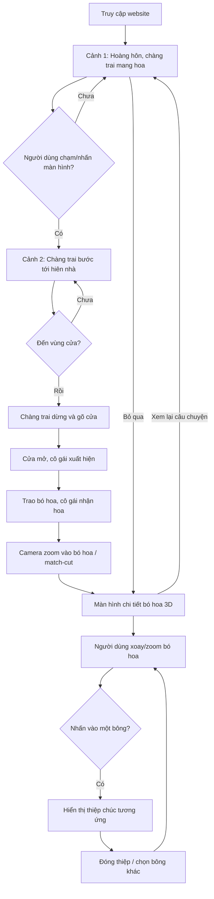

# ROSE WISHES — KỊCH BẢN & ĐẶC TẢ TRIỂN KHAI WEBSITE 3D 20/10

> **Mục đích tài liệu:** Đây là tài liệu yêu cầu sản phẩm (PRD), kịch bản trải nghiệm, chỉ dẫn mỹ thuật và đặc tả kỹ thuật để một lập trình viên hoặc coding agent triển khai **tại local**. **Không coi tài liệu này là mã nguồn đã chạy.**
>
> **Ngôn ngữ giao diện:** Tiếng Việt. **Phong cách:** Realistic 3D, cinematic romance, ấm áp, tinh tế. **Thiết bị:** Desktop và mobile.

## 1. Mục tiêu

Tạo website chúc mừng ngày Phụ nữ Việt Nam 20/10 theo hình thức **câu chuyện tương tác**. Khi mở website, người xem thấy một chàng trai đang cầm bó hoa hồng và **chờ người dùng chạm/nhấn để bước về phía ngôi nhà** trong khung cảnh lãng mạn. Khi đến trước cửa, anh gõ cửa; cánh cửa mở, cô gái xuất hiện và nhận bó hoa. Camera tiến gần bó hoa, chuyển sang không gian xem bó hoa 3D. Người xem có thể xoay bó hoa và nhấn **từng bông trong 11 bông** để đọc **11 lời chúc khác nhau**.

### Nguyên tắc bắt buộc
- **Không mở trực tiếp màn hình bó hoa** khi truy cập lần đầu; phải có hành trình mở đầu và trao hoa.
- **Bó hoa xuyên suốt câu chuyện**: kiểu giấy gói, màu sắc và cách phối hoa ở cảnh trao hoa phải khớp với màn hình chi tiết. Có thể dùng cùng asset GLB, hoặc chuyển cảnh bằng match-cut nếu dùng ảnh/video 2.5D.
- **11 bông có danh tính riêng** (`rose-01` ... `rose-11`), hình dáng không giống nhau hoàn toàn; mỗi bông liên kết ổn định với đúng một lời chúc.
- Người dùng có thể **bỏ qua phần mở đầu**, xem lại câu chuyện, tắt âm thanh, đóng thiệp và trở lại toàn cảnh.
- Không tự động phát âm thanh trước tương tác đầu tiên; tuân thủ `prefers-reduced-motion`.
- Tránh phong cách hoạt hình/chibi. Không dùng hiệu ứng quá dày gây mất sự tinh tế.

## 2. Hành trình người dùng (user flow)



## 3. Storyboard theo cảnh

### Cảnh 1 — “Có một món quà dành cho em” (0–5 giây)
- **Bối cảnh:** Con đường lát đá dẫn đến ngôi nhà nhỏ có hiên, hàng rào thấp, hoa hồng leo, cây xanh, đèn dây vàng ấm. Hoàng hôn tím hồng, ánh sáng dịu; có vài cánh hoa bay theo gió.
- **Nhân vật nam:** Người trưởng thành, trang phục lịch sự nhẹ nhàng (sơ mi trắng/kem, quần tối màu), cầm bó 11 bông hồng bọc giấy kem hồng, nơ satin. Dáng đi chậm, tự nhiên.
- **Góc máy:** Wide shot 3/4, camera di chuyển nhẹ theo nhân vật; nhìn rõ con đường, cửa nhà và bó hoa.
- **Chữ:** “Có một điều anh muốn gửi đến em…” xuất hiện mềm ở mép trên hoặc góc trái, không che nhân vật.
- **Tương tác chính bắt buộc:** Chàng trai **đứng chờ ở điểm xuất phát**, không tự bước tới nhà. Hiển thị lời gợi ý `Chạm vào màn hình để anh bước đến bên em ♡` cùng hiệu ứng nhấp nháy rất nhẹ. Người dùng chạm/click **vùng cảnh 3D không phải UI** hoặc nhấn nút `Tiến đến ngôi nhà` để bắt đầu bước đi. `Bỏ qua` luôn khả dụng. Không yêu cầu nhấn liên tục hoặc nhấn đúng vị trí trên đường.
- **Phản hồi sau chạm:** Gợi ý mờ đi; chàng trai chuyển từ idle sang walk (blend khoảng 0,2–0,4 giây), bước theo lối đi; camera dolly/tracking mềm, lá và ánh sáng phản hồi tinh tế. Khóa lệnh bắt đầu trong lúc đang đi để tránh click liên tục làm reset animation.
- **Nếu người dùng chưa chạm:** Nhân vật chỉ có idle animation (thở, chỉnh nhẹ bó hoa), cảnh nền chuyển động rất ít; không tự kích hoạt sang cảnh 2.
- **Trên mobile:** Tap một lần; trên desktop: click hoặc phím Enter/Space khi nút bắt đầu được focus. Tương tác với `Bỏ qua`, âm thanh hay UI không được vô tình kích hoạt bước đi.
- **Chuyển cảnh:** Camera dolly chậm tiến gần nhà, không cắt gắt.

### Cảnh 2 — “Trước ngưỡng cửa” (5–9 giây)
- **Chỉ sau cú chạm/click bắt đầu ở Cảnh 1**, chàng trai mới đi đến **vùng tương tác trước cửa**. Không cần WASD hoặc chạm liên tục; sau lần chạm đầu tiên, nhân vật **tự đi theo đường dẫn** (spline/path) để trải nghiệm nhất quán trên điện thoại.
- Khi nhân vật đến waypoint `doorApproach`, chuyển trạng thái `AT_DOOR`, dừng di chuyển, quay người nhẹ về phía cửa.
- Nhân vật giơ tay gõ cửa 2 lần; có âm thanh gõ cửa **chỉ khi người dùng bật âm thanh**.
- Đèn hiên tăng sáng rất nhẹ, tay nắm cửa xoay, cánh cửa mở theo bản lề.
- Nếu animation lỗi hoặc chưa tải xong, cho phép nút `Mở cửa` để tiếp tục, tránh kẹt luồng.

### Cảnh 3 — “Bó hoa được trao” (9–14 giây)
- Cô gái trưởng thành xuất hiện trong khung cửa, mặc váy sáng màu thanh lịch; ánh sáng vàng từ nhà tạo cảm giác ấm áp.
- Hai nhân vật nhìn nhau; chàng trai đưa bó hoa ra, cô gái đưa tay nhận. Không bắt buộc mô phỏng ngón tay vật lý: dùng animation pose + chuyển quyền gắn bó hoa từ tay nam sang tay nữ đúng thời điểm.
- Sau khi nhận, cô gái ôm bó hoa, cúi nhìn hoa rồi mỉm cười. Tránh cử động quá phô trương.
- Dòng chữ ngắn: “Chúc mừng ngày Phụ nữ Việt Nam 20/10”.
- **Điều kiện kết thúc:** Chỉ chuyển cảnh sau khi animation nhận hoa hoàn tất hoặc timeout an toàn.

### Cảnh 4 — “Mỗi đóa hoa, một lời thương” (14–17 giây)
- Camera tiến gần tâm bó hoa đang ở tay cô gái.
- Dùng **match-cut**: bó hoa lấp gần đầy khung hình, làm mờ nền, sau đó xuất hiện cùng bó hoa trong studio tối burgundy với ánh sáng mềm.
- Bó hoa xoay rất nhẹ rồi dừng ở góc mặc định đẹp nhất.
- Dòng hướng dẫn: “Kéo để xoay • Chạm vào từng bông hoa để mở lời chúc”.
- Chuyển quyền điều khiển sang người dùng, không tự xoay quá mạnh.

### Cảnh 5 — “11 lời chúc” (không giới hạn thời gian)
- Bó hoa 3D ở giữa màn hình, chiếm khoảng 60–70% chiều cao desktop, vừa khung trên mobile.
- Kéo chuột / vuốt một ngón để xoay; cuộn chuột / pinch để zoom; giới hạn góc và khoảng cách để không lật ngược bó hoa hoặc xuyên vào mesh.
- Hover trên desktop: bông sáng viền rất nhẹ, con trỏ đổi thành pointer. Trên mobile: chạm trực tiếp vào bông.
- Click: bông được chọn nổi bật; camera có thể tiến gần nhẹ, mở thiệp chứa lời chúc. Không thay đổi vị trí bông trong bó.
- Thiệp hiển thị bên phải trên desktop; bottom sheet trên mobile; không che kín toàn bộ hoa. Có nút `Đóng`, `Bông trước`, `Bông tiếp`, `Trở lại bó hoa`, `Xem lại câu chuyện`.
- Có thể thêm bộ đếm `Đã khám phá 3/11 bông` (lưu tạm trong session/localStorage, không bắt buộc).

## 4. Hướng mỹ thuật

### Bảng màu
| Vai trò | Màu | Hex |
|---|---|---|
| Nền chi tiết | Deep Burgundy | `#24131D` |
| Nền phụ | Wine | `#3B1C2B` |
| Hồng đỏ | Velvet Rose | `#A92846` |
| Hồng phấn | Blush Pink | `#EFA6B8` |
| Hồng kem | Ivory | `#F4E7D7` |
| Ánh đèn nhà | Warm Gold | `#F3C98B` |
| Chữ | Soft Ivory | `#FFF3EB` |

### Camera và ánh sáng
- Cảnh nhà: phối cảnh điện ảnh, 35–50mm tương đương, depth-of-field nhẹ (tắt/giảm trên mobile), ambient dusk, đèn hiên vàng.
- Cảnh hoa: key light ấm, fill light hồng nhẹ, rim light tinh tế để tách cánh hoa khỏi nền.
- Không lạm dụng bloom; giữ texture cánh hoa và giấy gói rõ ràng.
- Nhân vật và nhà có bóng đổ mềm; tránh shadow quá nặng trên mobile.

### Typography
- Heading: font serif thanh lịch hỗ trợ tiếng Việt (ví dụ Playfair Display hoặc font serif khác có đủ dấu).
- Nội dung: sans-serif dễ đọc (ví dụ Be Vietnam Pro).
- Không để chữ đè lên mặt nhân vật, tay trao hoa hoặc các bông cần click.

## 5. Asset cần chuẩn bị

> **Không có asset đi kèm file Markdown này.** Lập trình viên cần tải hoặc tự tạo asset có giấy phép phù hợp. Không được coi các đường dẫn dưới đây là file đã tồn tại.

| Asset | Gợi ý | Định dạng ưu tiên |
|---|---|---|
| Chàng trai | Nhân vật người trưởng thành có rig + animation đi bộ, gõ cửa, đưa hoa | `.glb` |
| Cô gái | Nhân vật người trưởng thành có rig + animation mở cửa, nhận hoa, mỉm cười | `.glb` |
| Ngôi nhà | Nhà nhỏ có cửa là mesh riêng với pivot tại bản lề | `.glb` |
| Ngoại cảnh | Đường lát đá, hàng rào, cây, hoa leo, đèn hiên | `.glb`, texture WebP |
| Hoa hồng | Ít nhất 3–5 mẫu: nở lớn, hé nở, nụ, cánh lệch | `.glb` |
| Bó hoa | Giấy gói, lá phụ, cành, nơ, điểm gắn trong tay | `.glb` |
| Âm thanh | Nhạc nền có giấy phép, gõ cửa, ambience nhẹ | `.mp3`/`.ogg` |
| HDRI | Môi trường ánh sáng hoàng hôn/studio | `.hdr`/`.exr` |

**Nguồn tham khảo để tự tìm asset:** Sketchfab (lọc Downloadable và kiểm tra license), CGTrader, Fab, Poly Haven (CC0 cho những asset thực sự có sẵn). Mixamo có thể hỗ trợ animation nhân vật tương thích rig. Không giả định mọi asset đều miễn phí hoặc được phép dùng thương mại.

**Lưu ý quan trọng:** Mô hình nhân vật photorealistic + animation trao vật chính xác là phần khó nhất. Không được hứa hẹn hoạt ảnh mượt chỉ từ một ảnh tĩnh. Cần asset có rig/animation hoặc triển khai fallback bên dưới.

## 6. Hai phương án triển khai cảnh mở đầu

### A — Khuyến nghị nếu có asset 3D phù hợp: full 3D
- Toàn bộ nhân vật, nhà, cửa và bó hoa ở cùng cảnh Three.js.
- Chàng trai di chuyển theo spline, animation mixer blend walk → idle → knock → handover.
- Cửa quay quanh bản lề bằng transform group; cô gái bước ra và nhận bó hoa.
- Bó hoa dùng chung prefab giữa scene mở đầu và scene chi tiết.
- Ưu điểm: đồng nhất góc nhìn, chuyển cảnh đẹp. Nhược điểm: phụ thuộc nhiều vào rig/animation và thời gian làm asset.

### B — Phương án thực dụng khi chưa có mô hình nhân vật: cinematic 2.5D + 3D bouquet
- Cảnh 1–3 dùng **ảnh nền/nhân vật phân lớp hoặc các đoạn video ngắn có bản quyền sử dụng**, có chuyển động camera giả lập parallax, fade, và những keyframe chuyển cảnh.
- Cửa có thể là lớp riêng với animation CSS/3D; trao hoa được thể hiện bằng chuỗi khung hình hoặc video dựng sẵn, không giả làm tương tác 3D thực.
- Cảnh 4 dùng zoom/match-cut vào bó hoa; cảnh 5 là bó hoa **3D thực** với raycasting cho từng bông.
- Ưu điểm: triển khai nhanh, hình ảnh nhân vật có thể đẹp hơn khi không có rig. Nhược điểm: người dùng không thể tự do đổi góc nhìn ở cảnh mở đầu.
- **Đây là fallback được chấp nhận** nhưng phải thông báo rõ nếu triển khai theo phương án này.

## 7. Kiến trúc kỹ thuật

### Stack
- Vite + React + TypeScript.
- `three`, `@react-three/fiber`, `@react-three/drei`.
- `framer-motion` hoặc `motion` cho UI transition.
- CSS/Tailwind cho responsive.
- Zustand **tùy chọn** cho state; có thể dùng React Context/useReducer để tránh phụ thuộc không cần thiết.
- GLTF/GLB + texture WebP/KTX2; lazy load, preloading và nén mesh khi thích hợp.

### Cấu trúc thư mục đề xuất

```text
rose-wishes-20-10/
├── README.md
├── package.json
├── index.html
├── public/
│   ├── models/
│   │   ├── characters/
│   │   ├── house/
│   │   └── flowers/
│   ├── textures/
│   ├── audio/
│   └── images/
├── src/
│   ├── app/App.tsx
│   ├── scenes/IntroScene.tsx
│   ├── scenes/DoorScene.tsx
│   ├── scenes/HandoverScene.tsx
│   ├── scenes/BouquetScene.tsx
│   ├── components/Bouquet.tsx
│   ├── components/Rose.tsx
│   ├── components/WishCard.tsx
│   ├── components/SceneOverlay.tsx
│   ├── components/AudioToggle.tsx
│   ├── data/roses.ts
│   ├── data/wishes.ts
│   ├── hooks/useSceneFlow.ts
│   ├── styles/global.css
│   └── main.tsx
└── docs/
    └── ROSE_WISHES_20_10_SPEC.md
```

### State machine

```ts
type SceneState =
  | 'LOADING'
  | 'INTRO_READY' // đứng chờ người dùng chạm/click
  | 'WALKING' // chỉ vào trạng thái này sau tương tác
  | 'AT_DOOR'
  | 'KNOCKING'
  | 'DOOR_OPENING'
  | 'HANDOVER'
  | 'BOUQUET_TRANSITION'
  | 'BOUQUET_EXPLORE';

type AppState = {
  scene: SceneState;
  selectedRoseId: string | null;
  discoveredRoseIds: string[];
  audioEnabled: boolean;
  reducedMotion: boolean;
};
```

- `INTRO_READY → WALKING` **chỉ xảy ra sau** `startWalk()` do thao tác chạm/click/Enter/Space hợp lệ; tuyệt đối không tự chạy theo timer. `startWalk()` idempotent, bỏ qua lệnh lặp.
- Tất cả transition phải có điều kiện hoàn tất animation hoặc timeout an toàn.
- `skipIntro()` chuyển trực tiếp sang `BOUQUET_EXPLORE` sau khi model hoa đã sẵn sàng.
- `replayIntro()` reset camera/animation/scene, không bắt buộc xóa danh sách hoa đã xem.
- Khi scene chưa sẵn sàng, hiện loading/progress và nút thử lại nếu lỗi tải asset.

### Tương tác chạm để chàng trai bắt đầu đi (Cảnh 1 → Cảnh 2)
- Mặc định vào `INTRO_READY`, nhân vật đứng ở `startWaypoint` và phát `idle` loop; hiển thị CTA `Chạm vào màn hình để anh bước đến bên em ♡`.
- Bắt sự kiện `onPointerDown` trên mặt phẳng/vùng tương tác của **cảnh**, hoặc nút HTML `Tiến đến ngôi nhà`. Chỉ chấp nhận khi `scene === 'INTRO_READY'`; không đặt listener toàn trang làm click vào `Bỏ qua` cũng kích hoạt.
- Khi kích hoạt, gọi `startWalk()` một lần, chuyển sang `WALKING`, blend `idle → walk`, chạy animation nhân vật và tiến theo spline đến `doorApproach`.
- Cú chạm **không dịch chuyển tức thời** nhân vật đến vị trí người dùng chạm; đây là tương tác bắt đầu hành trình, không phải điều khiển point-and-click. Các lần chạm tiếp theo trong `WALKING` không làm thay đổi đường đi.
- CTA biến mất sau lần chạm đầu; có thể hiển thị chỉ dẫn nhỏ `Anh đang đến...` nhưng không bắt buộc.
- Nếu asset/animation chưa sẵn sàng, giữ nút disabled hoặc hàng chờ một lệnh duy nhất, hiển thị loading; không làm mất thao tác của người dùng.
- Với `prefers-reduced-motion`, vẫn cần cú chạm, nhưng rút ngắn chuyển động và có thể chuyển nhanh đến `AT_DOOR`.
- Kiểm thử cả click desktop, tap mobile, keyboard Enter/Space, không kích hoạt kép do pointer/click bubbling.

### Hành vi ở vùng cửa
- Dùng **waypoint/trigger volume** `doorTrigger` (Box3 hoặc collider đơn giản), không dựa vào số giây cứng.
- Khi vị trí nhân vật đi vào trigger và `scene === 'WALKING'`, gọi `onReachDoor()` đúng một lần.
- `onReachDoor()` → dừng path animation → knock → open door → show girl → handover.
- Không cho phép trigger lại trong cùng một lượt, kể cả khi animation bị rerender.
- Cửa mở bằng `rotation.y` của nhóm có pivot tại bản lề; không quay cả ngôi nhà.

### Tương tác với 11 bông
- Dùng raycasting mặc định của React Three Fiber; gắn handler ở group/mesh của **từng bông**, không gắn chung cho cả bó.
- Gọi `event.stopPropagation()` khi click bông; không kích hoạt click xuyên xuống các bông phía sau.
- Bông được chọn lưu bằng ID cố định; không dùng array index làm ID lâu dài.
- Khi dùng nhiều bản sao GLB, clone object đúng cách; nếu thay màu từng bông, clone material riêng để không làm đổi màu đồng loạt.
- Nếu GLB có skinned mesh, cân nhắc `SkeletonUtils.clone` thay cho `scene.clone` đơn giản.
- Trên mobile cần vùng hit target đủ lớn; có thể thêm collider vô hình riêng quanh từng bông.

### Cấu trúc dữ liệu hoa

```ts
type RoseDefinition = {
  id: string;
  modelVariant: 'open' | 'halfOpen' | 'bud' | 'asymmetric';
  color: string;
  scale: number;
  position: [number, number, number];
  rotation: [number, number, number];
  wishId: string;
};
```

11 bông cần biến thể rõ ràng về: **loại nụ, độ nở, số lớp cánh, hướng cánh, tỷ lệ, góc nghiêng, màu và độ cao**. Không chỉ nhân bản cùng một mesh rồi đổi màu.

## 8. Dữ liệu 11 lời chúc (nội dung mặc định, có thể sửa)

| ID bông | Kiểu hoa | Tiêu đề thiệp | Nội dung |
|---|---|---|---|
| rose-01 | Đỏ nhung, nở lớn | Điều đẹp nhất | Chúc em ngày 20/10 ngập tràn niềm vui. Mong mỗi ngày đều có một lý do thật dịu dàng để em mỉm cười. |
| rose-02 | Hồng phấn, hé nở | Dịu dàng với chính mình | Mong em luôn yêu thương bản thân, nghỉ ngơi khi mệt và tự hào về những điều mình đã cố gắng. |
| rose-03 | Kem, nụ nhỏ | Những khởi đầu mới | Chúc những dự định của em từng chút một nở hoa, như nụ hồng đang chờ ngày rực rỡ. |
| rose-04 | Đỏ rượu, cánh xoắn | Luôn tỏa sáng | Em không cần giống bất kỳ ai. Chúc em luôn tự tin với vẻ đẹp và ánh sáng riêng của mình. |
| rose-05 | Hồng pastel, nở lệch | Bình yên nhé | Mong những ngày bận rộn vẫn dành cho em một khoảng trời bình yên và ấm áp. |
| rose-06 | Đỏ nhung, hé nở | Một chút may mắn | Chúc em gặp những điều tốt lành, những người chân thành và thật nhiều cơ hội tuyệt vời. |
| rose-07 | Hồng đào, nở lớn | Nụ cười của em | Mong nụ cười của em luôn được nâng niu, không chỉ hôm nay mà cả những ngày rất đỗi bình thường. |
| rose-08 | Trắng kem, cánh dày | Cảm ơn em | Cảm ơn em vì đã hiện diện và mang đến những điều đẹp đẽ theo cách riêng của mình. |
| rose-09 | Hồng đậm, nụ cao | Ước mơ của em | Chúc em đủ dũng cảm để bước tới điều mình mong muốn và đủ kiên nhẫn để tận hưởng hành trình. |
| rose-10 | Đỏ ruby, nở vừa | Được yêu thương | Mong em luôn được lắng nghe, thấu hiểu, trân trọng và yêu thương một cách chân thành. |
| rose-11 | Hồng phấn, nở lớn | Dành riêng cho em | Một bó hoa nhỏ thay cho ngàn lời chúc: chúc em hạnh phúc, rạng rỡ và luôn là chính mình. Chúc mừng 20/10! |

> Tất cả lời chúc là mẫu mặc định, không gắn tên hay thông tin cá nhân. Có thể sửa trong `src/data/wishes.ts`.

## 9. Chi tiết UI theo thiết bị

### Desktop (>= 1024px)
- Intro: cảnh nhà toàn màn hình; text ở góc trái, điều khiển ở góc phải; nhân vật và cửa ở vùng trung tâm.
- Bouquet: canvas 3D chiếm chính giữa; thiệp nổi bên phải; không che quá 35% chiều rộng.
- Dòng hướng dẫn ngắn phía dưới, các nút âm thanh / replay / reset camera ở góc.

### Mobile (< 1024px)
- Intro: camera framing giữ cả nhân vật và cửa; có thể dùng camera riêng hoặc crop có kiểm soát.
- Bouquet: hoa nằm phía trên; thiệp mở dưới dạng bottom sheet, có nút đóng rõ ràng.
- Vuốt trên canvas để xoay, nhưng không khóa cuộn trang ở các vùng UI khác.
- Nút có kích thước chạm tối thiểu khoảng 44×44px; font thiệp dễ đọc, không cần zoom màn hình.
- Giảm particle, bóng động và post-processing trên thiết bị yếu.

## 10. Âm thanh và accessibility
- Nhạc piano/ambient tùy chọn, chỉ bắt đầu sau thao tác chủ động của người dùng.
- Mặc định có thể **tắt tiếng**; nhớ lựa chọn trong session.
- Cung cấp `aria-label` cho các nút; hỗ trợ Tab/Enter cho danh sách 11 bông thay thế thao tác click canvas.
- Nếu `prefers-reduced-motion: reduce`, rút ngắn animation, bỏ camera dolly mạnh, vẫn giữ đầy đủ nội dung và chức năng.
- Nếu WebGL không hỗ trợ, hiển thị ảnh bó hoa + danh sách 11 nút mở lời chúc.

## 11. Hiệu suất và độ tin cậy
- Lazy-load scene chi tiết hoặc preload trong lúc intro chạy; không tải lại cùng asset không cần thiết.
- Tối ưu GLB (mesh compression khi phù hợp), texture WebP/KTX2, giới hạn DPR theo thiết bị.
- Tránh tạo 11 renderer/canvas; ưu tiên một canvas với chuyển scene/camera hợp lý.
- Đảm bảo cleanup animation, event listener, timers khi unmount; không chạy animation hai lần do Strict Mode.
- Không sử dụng asset bên ngoài qua hotlink không ổn định khi đưa lên production.
- Nếu thiếu model nhân vật/nhà, dùng fallback có chủ đích, không để màn hình trắng.

## 12. Thứ tự thực hiện khuyến nghị

### Milestone 1 — Luồng hoạt động không phụ thuộc asset
- Dựng React app, state machine và UI.
- Dùng placeholder đơn giản để mô phỏng chàng trai, nhà, cửa và cô gái.
- Hoàn tất luồng `INTRO_READY → (chạm/click) → WALKING → AT_DOOR → KNOCKING → DOOR_OPENING → HANDOVER → BOUQUET_EXPLORE`.
- Bỏ qua intro, replay và nút âm thanh hoạt động.

### Milestone 2 — Bó hoa 3D tương tác
- Tạo/nhập 3–5 mẫu hoa, biến thể thành 11 bông.
- Gán ID, raycast click, 11 lời chúc, camera controls và wish card.
- Kiểm thử từng bông kể cả bông phía sau khi xoay.

### Milestone 3 — Thay asset cinematic
- Thay placeholder bằng asset có giấy phép và chất lượng phù hợp.
- Làm animation đi bộ, gõ cửa, mở cửa, trao hoa hoặc dựng 2.5D fallback.
- Đồng nhất bó hoa giữa cảnh trao và cảnh chi tiết.

### Milestone 4 — Polish và tối ưu
- Hoàn thiện ánh sáng, cánh hoa rơi, âm thanh tùy chọn, transition match-cut.
- Kiểm thử desktop, iOS Safari, Android Chrome; tối ưu tốc độ và accessibility.

## 13. Tiêu chí nghiệm thu (acceptance criteria)

- [ ] Truy cập website thấy cảnh chàng trai cầm hoa và ngôi nhà lãng mạn, không vào thẳng bó hoa.
- [ ] Ở cảnh đầu, chàng trai đứng chờ và có lời nhắc chạm/click; **không tự đi khi chưa tương tác**.
- [ ] Chạm/click cảnh hoặc nhấn nút bắt đầu **một lần** khiến chàng trai đi tới nhà; click lặp không reset/chồng animation; click nút Bỏ qua không làm anh bắt đầu đi.
- [ ] Chàng trai di chuyển tới vùng cửa, dừng, gõ cửa; cửa mở theo bản lề.
- [ ] Cô gái xuất hiện và nhận bó hoa; camera chuyển mượt vào bó hoa.
- [ ] Có nút bỏ qua intro và xem lại câu chuyện, không bị kẹt khi asset/animation lỗi.
- [ ] Bó hoa có **đúng 11 bông tương tác**, không giống hệt nhau về hình dáng.
- [ ] Có thể xoay/zoom trên desktop và mobile.
- [ ] Nhấn bông nào hiện đúng lời chúc bông đó; có thể đóng và chọn bông khác.
- [ ] Thiệp không che toàn bộ bó hoa, chữ tiếng Việt hiển thị đúng dấu.
- [ ] Không tự phát nhạc; có tắt/bật tiếng; có hỗ trợ reduced motion.
- [ ] Website có fallback khi WebGL không khả dụng và không bị màn hình trắng nếu thiếu asset.
- [ ] Không có lỗi nghiêm trọng trong console; build production thành công.

## 14. Prompt giao việc cho coding agent ở local

> Hãy đọc toàn bộ `ROSE_WISHES_20_10_SPEC.md` và triển khai dự án Vite + React + TypeScript + React Three Fiber theo đúng các cảnh, luồng state và acceptance criteria. Ưu tiên làm luồng end-to-end hoạt động trước khi polish. Nếu chưa có asset nhân vật/nhà, dùng placeholder hoặc cinematic 2.5D được ghi rõ, không giả định file GLB đã tồn tại. Tạo 11 bông 3D có ID riêng và 11 lời chúc đúng dữ liệu, hỗ trợ xoay, zoom, click, **chạm/click để nhân vật bắt đầu đi từ cảnh 1 sang cảnh 2 (không autoplay)**, skip intro, replay, responsive, reduced motion và WebGL fallback. Viết README với lệnh `npm install`, `npm run dev`, `npm run build`, hướng dẫn đặt asset vào `public/`, và liệt kê chính xác các asset còn thiếu. Không tự nhận đã hoàn thành realistic animation nếu chưa có rig và model thật.

---

**Định nghĩa thành công:** Người nhận cảm thấy đang chứng kiến một chàng trai mang hoa tới tận cửa, nhận món quà, rồi tự mình khám phá từng lời chúc được giấu trong những bông hồng.
