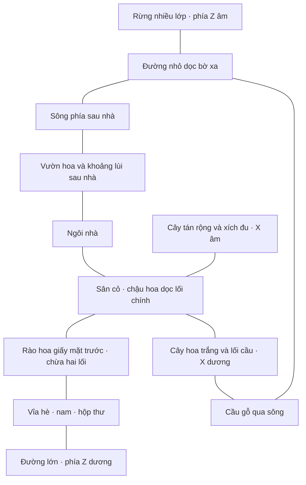

# Thiết kế bối cảnh và bố trí không gian

Tài liệu mô tả cảnh lắp trong src/scenes/Story.tsx. Đơn vị Three.js được dùng gần tỷ lệ mét để dễ bố trí; không phải bản vẽ thi công. Tọa độ dưới đây là tọa độ thế giới, trừ khi ghi cục bộ.

## 1. Hướng nhìn và các lớp không gian

Y hướng lên. Nhà quay mặt về **Z dương**, phía đường lớn và điểm xuất phát của nam. Ra phía sau nhà là đi về **Z âm**. X âm là bên xích đu, X dương là bên cầu. “Trái/phải” dùng quy ước này thay vì góc nhìn khi camera thay đổi.

Sơ đồ thể hiện quan hệ, không theo tỷ lệ. Tiền cảnh là đường/rào/nam; trung cảnh là sân, hoa và nhà; hậu cảnh là vườn sau, sông và rừng. Các lớp tạo chiều sâu và làm rõ điểm đến.

## 2. Nhà và hiên

Cottage.tsx dựng nhà tường kem, mái ngói nâu, ống khói. Khối tường rộng khoảng 6,6, sâu 3,6, cao 3,7; mặt trước Z ≈ −2,15, lưng nhà ≈ −5,75. Đỉnh mái Y ≈ 4,8, nắp ống khói ≈ 5,4. Tỷ lệ nhà đủ lớn so với cửa và nhân vật.

Hai cửa sổ tại X ≈ ±2,25 có khung kem, kính ấm, thanh chia và bệ. Tường dùng texture plaster và bump nhẹ. Mái có nhiều hàng ngói đổi sắc độ. GardenDetails trong Atmosphere.tsx thêm ba bậc thềm, trụ hiên, dầm ngang và đèn. Dây đèn trước nhà cao khoảng 3,05 và võng nhẹ ở giữa.

DoubleDoor.tsx dựng **hai cánh mở vào trong**, bản lề tại X = ±0,65, Y = 0,39, Z = −2,06. Khung dày 0,032; panel và kính mỏng hơn. Cánh mở đối xứng đến khoảng ±1,42 radian, giảm quét qua bó hoa từ phía ngoài. Chuyển động tính theo thời gian, không mô phỏng khối lượng cửa.

Hốc và nền trong nhà lùi sau cửa. Nữ xuất hiện tại [0.15, 0.37, -1.8]; Y = 0,37 giữ chân trên cao độ hiên.

## 3. Sân trước, chậu hoa và hộp thư

isFrontLawn() trong gardenLayout.ts định nghĩa sân cỏ chính: |X| < 5,25 và −1,05 < Z < 4,85. FlowerGarden.canPlant() loại vùng này khỏi hoa phủ đất, để sân có khoảng thở.

Lối chính có **19 viên đá**, tâm gần X = 0, từ Z = 4,33 về −1,43. Viên rộng 1,22, bo góc và lệch xoay nhẹ. Lối dừng trong khuôn viên, không kéo qua mặt đường.

**Tám chậu hoa** xếp hai hàng X = ±1,03, mỗi bên tại Z = 3,8 / 2,65 / 1,5 / 0,35. Chậu đất nung có hoa nhỏ trắng, hồng, tím và thân xanh. Hai chậu GLB sát hiên do PorchPlants.tsx dựng là nhóm riêng.

Hộp thư ở [1.05, 0, 5.05], gần đầu đường vào và nơi nam đứng, không sát cửa. Cần giữ khoảng trống để thấy hộp thư khi chỉnh rào hoặc cây.

## 4. Rào hoa giấy chỉ ở mặt trước

FlowerFence.tsx tạo rào thấp: khung kim loại mảnh, bệ sáng và hoa giấy phủ lên. Lá xanh, lá bắc hồng/tím hồng xen đỏ hồng; cao độ và độ rủ thay đổi. Hình học lá bắc nhọn, khum và không phẳng đều nhằm gợi chất giấy mỏng.

Rào tại **Z = 4,55**, có ba đoạn:

| Đoạn | Phạm vi X | Vai trò |
| --- | --- | --- |
| Trái | −10 đến −1,45 | Viền trước vườn bên xích đu |
| Giữa phải | 1,65 đến 5,35 | Viền trước sân bên phải |
| Ngoài phải | 7,25 đến 11 | Nối tiếp sau khoảng mở đi cầu |

Khoảng −1,45 đến 1,65 dành cho lối chính; khoảng 5,35 đến 7,25 dành cho lối cầu X = 6,3. Lá/hoa vươn khỏi khung nên phải tính cả tán khi chỉnh độ rộng. Bệ cao 0,13, khung khoảng 1,24; hoa nhô cao thấp quanh khung. Rào **không chạy hai bên hoặc sau nhà**, không có cổng đóng/mở.

Khung, thân, lá và hoa dùng bốn nhóm InstancedMesh và các bệ tĩnh. Đây là trang trí, không tương tác mở thiệp và không có hệ va chạm vật lý.

## 5. Xích đu và cây bóng mát bên trái

Xích đu ở [-3.95, 0, 0.55], xoay Y = 0,22. Chân chữ A mở rộng dưới và thu vào trên; thanh ngang Y ≈ 2,32. Ghế gỗ có tựa, dây và đệm hồng trầm. Ghế dao động góc nhỏ; reduced motion giữ đứng yên. Bảy viên đá nối lối chính sang ghế; vùng dưới ghế và đường tiếp cận được chừa hoa.

Cây chính tại khoảng [-4.85, 0, -0.45] có nhiều nhánh cong, tán tỏa ngang rộng theo từng tầng mỏng, hướng theo ảnh cây bóng mát người dùng cung cấp. Tán cần bao vùng xích đu, không thành một khối cầu nhỏ. GardenTrees.tsx tạo cây bằng hình học thủ tục, không tải GLB.

## 6. Hoa trắng, vườn bên và cây viền

FlowerGarden.tsx rải hoa thấp thành mảng kem, hồng, tím và vàng nhạt. Vườn mở rộng sang trái khoảng X = −23,5, sang phải ≈ 13,65; vùng nhà, sân cỏ, đường, gốc cây, hộp thư và xích đu được loại khỏi nơi trồng.

BlossomTrees.tsx tạo **năm cây hoa trắng** từ blossomTreeSites. Mỗi cây có nhánh cong, 700 hoa nhỏ và 220 lá instanced. Chúng là điểm sáng xen mảng xanh, không thay cây bóng mát.

Cây hoa trắng sân trước bên phải ở **X = 3,65, Z = 1,6**, scale 0,78, xoay Y = π/2. Đây là cây ở bãi cỏ **phía trước**, hướng cầu, không ở góc sau sát sông. Các cây khác nối những mảng vườn bên ngoài. GardenBorder.tsx thêm cây viền và bụi cây xa lối chính.

## 7. Đường phố, sông, cầu và rừng

Neighborhood.tsx hiện chỉ có đường, vỉa hè và vạch đường; không còn nhà hàng xóm. Mặt đường tâm Z = 8,85, rộng 4,4 theo Z; vỉa hè phía nhà tâm ≈ 5,75. Nam đứng chờ tại [0, 0, 5.6].

Countryside.tsx dời cả nhóm Z = −3,2. Sông tâm cục bộ −10,05 nên tâm thế giới **−13,25**, rộng 6,3. Bờ gần khoảng Z = −9,85. Giữa lưng nhà và bờ là khoảng vườn, không ép nhà sát nước.

Cầu gỗ bên phải tại X = 6,3 có ván ngang, mặt cong nhẹ, trụ và tay vịn. Đầu gần Z ≈ −9,65, đầu xa ≈ −16,9. **Lối ra cầu tách trực tiếp từ đường lớn**, gồm 41 viên đá từ Z = 6,45 về −9,55; không tách ngang từ lối vào nhà qua sân.

Đường bờ xa nằm tại Z thế giới ≈ −17,5, rộng 1,4; có lối ngắn nối vào rừng. Forest.tsx có 240 cây theo sáu lớp, mỗi cây chín cụm tán. Forest nằm trong Countryside nên phải cộng phép dời −3,2 khi tính thế giới. Rừng đã thay ruộng lúa.

## 8. Giới hạn kỹ thuật

Nước dùng shader gợn sáng, không mô phỏng dòng chảy. Cây, rào và đất không có hệ va chạm nhân vật tổng quát. Lối đi thông nhờ bố trí và vùng loại trừ. Khi thay tọa độ lớn cần kiểm tra toàn cảnh và luồng trao hoa, không chỉ một góc tĩnh.

