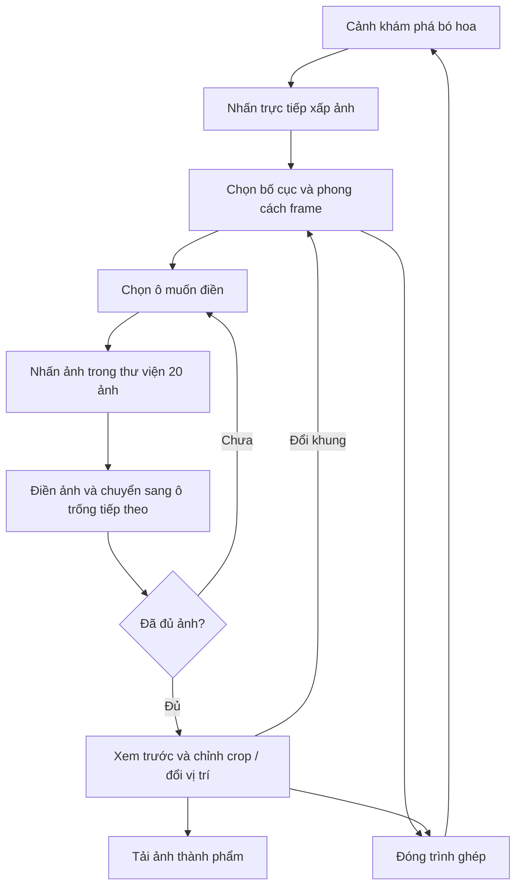

# Photobooth — 20 khoảnh khắc, 10 lời thương

**Ngày lập:** 02/11/2026.  
**Cập nhật tài liệu:** 08/11/2026.  
**Trạng thái:** Đã triển khai; hiện dùng 20 link ảnh mẫu Lorem Picsum, có thể thay bằng link hoặc file ảnh chính thức.  
**Phạm vi tài liệu:** Đặc tả đã thảo luận và ghi chú bản triển khai hiện hành. Chủ dự án đã chọn dùng bộ ảnh cố định.

### Bản triển khai hiện tại

- `src/photobooth/data.ts`: 16 bố cục, 8 phong cách frame và dữ liệu bản nháp. photoCatalog.ts cung cấp danh mục 20 ID ảnh dùng chung, tách khỏi hình học bố cục. `decorations.ts` và `specialFrames.ts` vẽ họa tiết dùng chung cho preview và PNG.
- `src/photobooth/photos.json`: danh mục 20 ảnh; `src` là ảnh gốc để ghép, `thumb` là ảnh nhỏ; chấp nhận đường dẫn local hoặc link HTTPS trực tiếp. Chế độ demo giữ thông tin nguồn/tác giả ảnh Picsum.
- Khi cấu hình API nội dung, danh mục ảnh hợp lệ từ API có ưu tiên cho cả thư viện, xấp ảnh và PNG; `photos.json` giữ vai trò dự phòng. Xem [content-api.md](content-api.md).
- `src/photobooth/Photobooth.tsx`: chọn khung/ảnh, crop, kéo hoán đổi, popup xóa ảnh, focus và VI/EN.
- `src/photobooth/render.ts`: dùng chung phép crop và lớp khung cho preview và PNG.
- `src/photobooth/PhotoStack.tsx`: xấp ảnh 3D có vùng nhấn và focus trùng khung ảnh; viền sáng khi hover/focus, giữ góc nhìn bó hoa khi đóng trình ghép.
- `scripts/prepare-photobooth-photos.mjs`: xử lý đúng 20 nguồn trong `art/photos/originals/`, xuất WebP tối đa 1600px và thumbnail 320px sang `public/photos/`.
- `scripts/check-photobooth.mjs`: kiểm tra 16 bố cục × 8 phong cách, 128 PNG, đổi frame giữ ảnh/crop, ảnh lỗi/thử lại, draft, focus, ngôn ngữ và mobile. Ảnh thử chỉ được chặn riêng trong QA, không phân phối thành ảnh thật.

Chạy `node scripts/check-photobooth.mjs --remote` để kiểm tra với các ảnh thật từ link đã cấu hình, bao gồm xuất PNG và CORS. Mặc định script vẫn dùng ảnh QA được chặn riêng. Ảnh từ link được nạp bằng anonymous CORS trước khi vẽ Canvas; máy chủ ảnh cần cho phép truy cập từ website. Dùng ID ảnh Picsum cố định để thumbnail và bản xuất cùng nội dung. Không dùng link ngẫu nhiên hoặc link trang xem ảnh thay cho link file.

Chạy `npm run prepare:photos` sau khi thêm `01`–`20` với một trong các đuôi JPEG/PNG/WebP/AVIF. Hiện chưa có bộ ảnh thật. Bản nháp lưu metadata/crop trong sessionStorage; không lưu ảnh base64. Cho phép chọn thủ công một ảnh ở nhiều ô; không có nút tự điền hoặc xáo trộn. Đổi sang khung ít ô vẫn giữ phần vượt trong mảng 20 ô để khôi phục. Chữ xuất theo ngôn ngữ đang chọn. Kích thước PNG khai báo riêng từng khung, từ 900×2400 ở dải dọc đến 2000×2800 ở mẫu 20 ảnh.

## 1. Ý tưởng và mục đích

Bổ sung ý nghĩa cho số **20** trong ngày **20/10** bằng bộ **20 tấm ảnh**, kết hợp với **10 bông hoa / 10 lời chúc** đang có. Thông điệp chung: **“20 khoảnh khắc, 10 lời thương.”**

Người xem mở một xấp ảnh nằm cạnh bó hoa, chọn mẫu khung photobooth rồi chọn ảnh đưa vào các ô. Sau khi chỉnh bố cục, người xem tải xuống một ảnh thành phẩm gồm khung và toàn bộ ảnh đã chọn.

Đây là tính năng chọn và ghép ảnh, chưa bao gồm chụp bằng camera trực tiếp như máy photobooth vật lý.

## 2. Phạm vi đã thống nhất trong trao đổi

- Có một xấp ảnh đặt cạnh bó hoa trong cảnh khám phá.
- Nhấn xấp ảnh để mở màn hình chọn khung và ảnh.
- Có tổng cộng **20 ảnh** trong thư viện.
- **Chọn khung trước**, sau đó nhấn ảnh để đưa vào khung đã chọn.
- Có nhiều bố cục, ưu tiên bố cục nhiều ảnh; bỏ các mẫu một ảnh.
- Có tính năng tải xuống khung đã chứa các ảnh người xem chọn.

Các phần sau giữ mô tả thiết kế đã thảo luận; các quyết định của bản triển khai hiện tại được ghi ở trên và tại mục 12.

## 3. Điểm mở tính năng trong cảnh 3D

### Xấp ảnh cạnh bó hoa

Thiết kế một xấp ảnh giấy có viền trắng, các tấm lệch góc nhẹ và xếp lớp tự nhiên. Đặt gần phần chân bó hoa, tránh che các bông chính hoặc vùng nhận thao tác xoay. Tấm trên cùng hé lộ một khoảnh khắc để tạo sự tò mò.

Không hiển thị nút chữ “20 khoảnh khắc” hoặc lời gợi ý riêng cạnh bó hoa. Nhấn trực tiếp khung ảnh; viền sáng nhẹ khi hover/focus để báo khả năng tương tác. Không mở ngay toàn bộ thư viện ở màn hình tải đầu tiên để giữ yếu tố bất ngờ.

Nhấn xấp ảnh sẽ mở trình ghép. Cần phân biệt thao tác nhấn với kéo xoay bó hoa để không mở nhầm khi người xem đang điều khiển cảnh.

### Điểm mở thay thế

Trên mobile chạm trực tiếp khung ảnh. Vùng nhận thao tác phủ cả tấm ảnh và hỗ trợ Enter/Space khi focus bằng bàn phím; nhãn “20 khoảnh khắc” chỉ dùng cho công nghệ hỗ trợ. Thiết bị không WebGL có khung ảnh giấy trong trải nghiệm thay thế, cũng nhấn trực tiếp lên ảnh.

Đóng trình ghép trở về góc bó hoa đang xem, giữ tiến độ đọc lời chúc và các lựa chọn ngôn ngữ, ngày/đêm, âm thanh. Không phát lại câu chuyện hoặc đặt lại camera chỉ vì mở/đóng photobooth.

## 4. Luồng sử dụng

Người xem có thể chỉnh hoặc đóng ở bất kỳ giai đoạn nào. Bản nháp được giữ trong phiên sử dụng theo phương án ở mục 7; không yêu cầu tải xuống mới được thoát.

## 5. Danh sách 16 bố cục hiện hành

Danh sách cuối cùng ưu tiên nhiều ảnh hơn các phương án đầu. **Không còn bố cục một ảnh.** Số hàng/cột dưới đây chỉ rõ hướng để tránh nhầm ký hiệu lưới.

| ID hiện hành | Số ảnh | Tên / dạng bố cục | Cấu trúc |
| --- | ---: | --- | --- |
| journal-2 | 2 | Hai ảnh kiểu nhật ký | Hai ảnh lệch nhẹ trên nền giấy |
| strip-3 | 3 | Photobooth cổ điển | Ba ảnh xếp thành một dải dọc |
| grid-4 | 4 | Lưới cân đối | 2 cột × 2 hàng |
| highlight-4 | 4 | Một khoảnh khắc nổi bật | Một ảnh lớn và ba ảnh nhỏ |
| grid-6 | 6 | Sáu khoảnh khắc | 2 cột × 3 hàng |
| double-strip-6 | 6 | Hai dải photobooth | Hai dải đặt cạnh nhau, mỗi dải ba ảnh |
| grid-8 | 8 | Tám khoảnh khắc | 2 cột × 4 hàng |
| highlight-8 | 8 | Một ảnh chủ đạo | Một ảnh nổi bật và bảy ảnh nhỏ |
| grid-9 | 9 | Gom những dịu dàng | 3 cột × 3 hàng |
| grid-12 | 12 | Trang ký ức | 3 cột × 4 hàng |
| grid-16 | 16 | Bộ sưu tập kỷ niệm | 4 cột × 4 hàng |
| grid-20 | 20 | Trọn bộ khoảnh khắc | 4 cột × 5 hàng |
| hearts-6 | 6 | Vòm chủ đạo | Một vòm lớn, hai ảnh tròn và ba ảnh dọc; giữ ID cũ để tương thích draft |
| clouds-6 | 6 | Thẻ ảnh so le | Sáu thẻ ảnh dọc xếp ba cột lệch cao độ, nghiêng nhẹ; giữ ID cũ để tương thích draft |
| petals-8 | 8 | Cánh hoa | Phối cánh hoa, trái tim và hình tròn |
| collage-10 | 10 | Panorama và vòm | Một ảnh ngang chủ đạo, ba vòm và sáu ảnh nhỏ phía dưới |

Mẫu **20 ảnh** là điểm nhấn gắn với ngày 20/10. Không ép tất cả mẫu dùng cùng một tỷ lệ thành phẩm: dải photobooth cần dáng dài, lưới cần tỷ lệ phù hợp để ảnh không quá nhỏ.

Chỉ giữ bố cục theo thiết kế gốc (nhóm As designed trước đây); không còn bộ chọn ép toàn bộ ảnh sang Hearts/Clouds/Circles/Arches/Petals. Hình dạng đã thiết kế trong từng bố cục vẫn giữ nguyên. `shapes.ts` định nghĩa đường bao chung cho Canvas, thumbnail SVG, clip-path của vùng bấm và popup crop; hình được giữ tỷ lệ và đặt vừa trong ô. Draft chỉ lưu bố cục/frame/ảnh/crop; trường `shapeId` cũ được bỏ qua khi đọc để khôi phục đúng thiết kế gốc mà không mất ảnh đã chọn.

Mỗi bố cục có tám phong cách frame để chọn bằng thumbnail thay cho nút chọn màu:

Thumbnail phong cách chỉ vẽ nền, viền, tiêu đề và họa tiết của frame trên tỷ lệ cố định 1600×2000; không có ô ảnh hoặc bố cục bên trong. Thay bố cục/hình dạng không làm đổi thumbnail phong cách. Bản xem trước lớn và PNG vẫn ghép đúng ảnh theo bố cục đang chọn.

- **Vườn thư tình:** giấy kem, dây leo và lá chạy hai bên, hoa nhỏ và sắc xanh lá dịu.
- **Nơ hồng & ren:** nền gingham hồng, viền ren và nơ ở góc ảnh.
- **Nhật ký yêu thương:** giấy kẻ dòng, viền giấy và băng dính trang trí.
- **Đêm lấp lánh:** nền tím đen chuyển hồng, sao sáng và nơ.
- **Cherry ngọt ngào:** nền chấm bi, tiêu đề sans đậm, trái tim và họa tiết cherry.
- **Cuộn phim 20/10:** giấy đen, lỗ cuộn phim hai bên, chữ monospace và số thứ tự trên mỗi ảnh.
- **Sổ tay kỷ niệm:** giấy ô ly, gáy lò xo, nhãn giấy tiêu đề, bóng giấy và băng dính ở mép ảnh.
- **Bưu thiếp gửi em:** viền hàng không đỏ xanh, tem 20 OCT, dấu bưu điện và đường viền ảnh nét đứt.

Phong cách là tùy chọn riêng, không tính thành bố cục mới: **16 bố cục × 8 phong cách**. Theme ngày/đêm không tự đổi thành phẩm. Các ID cũ và trường paletteId được giữ để khôi phục bản nháp cũ. Ba mẫu film/scrapbook/postcard có renderer nền, viền, chi tiết và caption riêng; tọa độ ảnh không đổi nên đổi phong cách giữ ảnh/crop. Họa tiết vẽ bằng Canvas, không tải ảnh trang trí bên ngoài; cùng renderer dùng cho thumbnail, preview và PNG.

Khung có khoảng cách ô, viền, trang trí, lời đề tặng và dấu **20/10** được thiết kế sẵn. Tránh trang trí phủ lên khuôn mặt hoặc chiếm quá nhiều diện tích ở mẫu 16–20 ảnh.

## 6. Màn hình chọn khung

Thumbnail cần thể hiện đúng vị trí/tỷ lệ các ô và số ảnh cần chọn. Nhấn một mẫu cập nhật khung xem trước và trạng thái ô ảnh.

Bộ lọc theo danh sách hiện hành: **Tất cả · 2–3 ảnh · 4–6 ảnh · 8–12 ảnh · 16–20 ảnh**. Không giữ bộ lọc một ảnh từ ý tưởng ban đầu vì nhóm này đã bị bỏ.

Nhãn hỗ trợ VI/EN; thẻ bố cục chỉ có sơ đồ và số ảnh, không hiển thị tên mẫu. Chỉ thay mẫu sau thao tác rõ ràng của người xem; không tự xoay vòng mẫu hoặc làm mất ảnh đã chọn.

## 7. Chọn ảnh và quản lý bản nháp

### Quy tắc đề xuất

1. Khi chọn khung, ô trống đầu tiên được chọn sẵn.
2. Nhấn một ảnh trong thư viện để điền vào ô đang chọn.
3. Sau khi điền, tự chuyển tới ô trống tiếp theo. Nếu đã đủ ảnh, giữ ô vừa thao tác để xem/chỉnh; không tự ghi đè một ô khác.
4. Nhấn ô đã có ảnh để thay hoặc chỉnh vùng cắt.
5. Hiển thị tiến độ rõ ràng, ví dụ **“Đã chọn 8/12 ảnh”**.

Khi đổi bố cục, giữ ảnh đã chọn theo thứ tự cho các ô mới. Nếu mẫu mới ít ô hơn, phần vượt được giữ trong bản nháp 20 ô để khi quay lại mẫu nhiều ô có thể khôi phục theo thứ tự. Ô trống đầu tiên của mẫu mới được chọn để điền tiếp.

Khi đóng và mở lại trong cùng phiên, giữ bố cục, phong cách frame, ảnh và crop. Bản triển khai dùng sessionStorage cho metadata/crop và có thể khôi phục khi tải lại cùng tab. Không cam kết giữ sau khi đóng phiên trình duyệt; không lưu dữ liệu ảnh lớn dạng base64 vào localStorage.

### Ảnh lặp

Bản triển khai cho phép dùng cùng ảnh ở nhiều ô. Người dùng chọn ảnh trực tiếp từ thư viện cho ô đang sáng; không còn nút tự điền hoặc xáo trộn.

## 8. Thao tác cho khung nhiều ảnh

- **Chỉnh ảnh:** nhấn vào ô đã có ảnh để mở popup crop/zoom. Ô trống chỉ được chọn để điền ảnh từ thư viện.
- **Xóa ảnh:** nút Xóa ảnh nằm cạnh Xong trong popup; xóa xong đóng popup và đưa focus về đúng ô trống đó.
- **Đóng popup:** Xong hoặc Escape giữ crop đã chỉnh và đưa focus về ô vừa thao tác. Các nút thao tác riêng bên dưới preview đã được bỏ.
- **Đổi chỗ:** vẫn có thể kéo ảnh giữa hai ô trên thiết bị hỗ trợ kéo thả. Trên mobile có thể xóa và chọn lại ảnh bằng các ô và thư viện.
- **Chỉnh crop:** kéo vị trí ảnh và phóng nhẹ trong ô; giữ tỷ lệ ảnh, không kéo méo.
- **Phóng bản xem trước:** trên mobile, mở vùng chỉnh ô lớn hơn thay vì buộc thao tác trong ô nhỏ của lưới 16–20 ảnh.
- **Cảnh báo độ phân giải:** so kích thước ảnh với vùng crop và kích thước ô xuất; ảnh không đủ nét cần được báo nhưng không tự thay bằng ảnh khác.

Mỗi ô có trạng thái trống / đang chọn / đã điền / ảnh lỗi. Nếu ảnh lỗi, cho đổi ảnh hoặc thử lại; giữ nguyên các ô còn lại.

## 9. Bố cục giao diện và khả năng truy cập

### Desktop

Hai cột chọn bố cục/phong cách và thư viện ảnh hiển thị đầy đủ, không giới hạn chiều cao và không có vùng cuộn riêng. Từ 1100px, cả ba cột dùng sticky cách đỉnh 20px; cuộn chung trong màn hình photobooth. Mobile giữ dải chọn ngang.

Trên mobile tới 700px, phong cách frame và bố cục có hai nút thu gọn/mở rộng độc lập, mặc định thu gọn. Nút luôn hiển thị phong cách hiện tại hoặc số ảnh; mở ra để xem dải lựa chọn và tự thu gọn khi chọn xong. Các nút có aria-expanded và aria-controls; phần đã thu gọn không tham gia thứ tự Tab. Desktop luôn hiển thị lựa chọn đầy đủ, không phụ thuộc trạng thái mobile.

Workspace không giới hạn max-width, dùng cùng mép container với header: lề 4% ở desktop, 5% từ 800px trở xuống. Chọn bố cục/phong cách bên trái, preview ở giữa, thư viện bên phải. Màn hình rộng tăng số cột thumbnail để hiển thị nhiều lựa chọn hơn. Thẻ bố cục chỉ hiển thị sơ đồ và số ảnh, không có tên riêng. Tiến độ và nút tải dễ thấy, không đè lên ảnh đang chỉnh.

### Mobile

Xem trước phía trên, mẫu khung và bố cục thu gọn/mở rộng. Thư viện 20 ảnh là một dải thumbnail vuông 64px vuốt ngang ngay dưới vùng ghép, bám phía trên thanh tải khi cuộn để chọn ảnh liên tục. ResizeObserver đo chiều cao thực tế của thanh tải và cập nhật khoảng bám, kể cả safe area hoặc nội dung trạng thái dài. Desktop giữ thư viện dạng lưới bên phải. Bỏ các tiêu đề đánh số, tiêu đề phong cách và tiêu đề thư viện trên cả hai kích thước; giữ nhãn trên nút thu gọn và nhãn ARIA cho các vùng. Ô đang chỉnh mở trong popup.

### Yêu cầu chung

Photobooth dùng chung `SiteHeader` với trang chính: giữ logo/thương hiệu, ẩn các nút ngôn ngữ/ngày đêm/âm thanh trong khi ghép và chỉ hiện nút đóng SVG được căn giữa. Ngôn ngữ/theme hiện tại vẫn được kế thừa. Thanh cuộn toàn trang dùng `scrollbar-width: thin`, track trong suốt và thumb theo màu nhấn, không có nền trắng hoặc nút mũi tên.

- Đồng bộ VI/EN và giao diện ngày/đêm với ứng dụng.
- Dành không gian ổn định cho nhãn dịch và trạng thái tải/xuất để hạn chế xê dịch.
- Bàn phím truy cập được mẫu, ảnh, ô và thao tác đổi chỗ; hiển thị focus rõ.
- Nếu mở dạng dialog: đặt focus vào trình ghép, kiểm soát focus trong dialog và trả về điểm mở khi đóng. Escape đóng lớp chỉnh con trước rồi mới đóng trình ghép.
- Nội dung hướng dẫn và mô tả ảnh có bản dịch phù hợp; không chỉ phân biệt trạng thái bằng màu.
- Tôn trọng reduced motion; không tự chạy hiệu ứng xáo ảnh liên tục.

## 10. Tải ảnh thành phẩm

Xuất **một file PNG** gồm nền khung, toàn bộ ảnh đã chọn, vị trí cắt, viền, trang trí và chữ. Đề xuất tên mặc định: **rose-wishes-20-10.png**.

Yêu cầu:

1. Chỉ cho xuất khi mọi ô bắt buộc đã có ảnh hợp lệ.
2. Chờ ảnh gốc giải mã và font sẵn sàng, không xuất thumbnail chất lượng thấp thay ảnh gốc.
3. Dùng cùng dữ liệu bố cục/crop cho xem trước và xuất để hình tải về khớp bản người xem đã chỉnh.
4. Giữ đúng tỷ lệ của mẫu; độ phân giải cụ thể từng mẫu được chốt trong bước thiết kế, có tính giới hạn bộ nhớ mobile.
5. Trong lúc xuất có trạng thái rõ, chặn nhấn tải liên tục; không làm mất bản nháp.
6. Nếu lỗi, giữ dữ liệu và cho thử lại.
7. Kiểm tra tải file thực tế trên trình duyệt mobile, bao gồm trường hợp hệ điều hành mở ảnh để lưu thay vì tải trực tiếp.

Ưu tiên ghép bằng Canvas từ ảnh gốc và các lớp trang trí đã chuẩn bị. Không chụp toàn bộ màn hình UI thành ảnh và không đưa nút chọn/điều khiển vào file tải.

Nếu ảnh được phục vụ từ nguồn bên ngoài, phải xử lý quyền truy cập/CORS trước khi vẽ Canvas; cấu hình ảnh không hợp lệ có thể làm không xuất được file. Với bộ ảnh cố định, ưu tiên đường dẫn cùng nguồn với website.

## 11. Tổ chức dữ liệu và kỹ thuật

Các nhóm dưới đây đã được triển khai theo danh sách tệp ở đầu tài liệu:

| Nhóm | Dữ liệu / trách nhiệm |
| --- | --- |
| Danh mục ảnh | 20 ID ổn định, ảnh gốc, thumbnail, kích thước, mô tả VI/EN, điểm lấy nét nếu có |
| Danh mục khung | ID, số ô, kích thước xuất, hình học ô, viền, chữ và bảng màu |
| Bản nháp | Khung/màu đang chọn, ô active, photo ID từng ô, crop/zoom, thứ tự lựa chọn |
| Điểm mở 3D | Xấp ảnh, thumbnail trên mặt giấy, nhận click và điểm mở DOM thay thế |
| Trình ghép | Chọn mẫu, chọn ảnh, crop, hoán đổi và xử lý lỗi |
| Bộ xuất | Vẽ cùng dữ liệu khung/crop ra PNG, quản lý trạng thái và bộ nhớ |

Tọa độ ô nên dùng hệ chuẩn hóa hoặc hệ thiết kế chung rồi scale theo kích thước hiển thị/xuất. Ảnh dùng ID, không phụ thuộc thứ tự mảng hoặc tên file hiển thị.

Đề xuất tải dữ liệu giao diện/thumbnail khi vào khám phá hoặc mở photobooth; ảnh gốc tải theo nhu cầu. Không đưa toàn bộ ảnh gốc vào danh sách GLB bắt buộc của màn tải mở đầu. Nếu photobooth lỗi, bó hoa và lời chúc vẫn phải sử dụng được.

## 12. Quyết định triển khai và dữ liệu còn thiếu

| Điểm | Phương án đề xuất / trạng thái |
| --- | --- |
| Nguồn 20 ảnh | Đã xác nhận bộ cố định do chủ dự án cung cấp |
| Bộ ảnh thực tế | Chưa có danh sách/file ảnh bàn giao cho tính năng này |
| Dùng lặp ảnh | Cho phép chọn thủ công cùng ảnh ở nhiều ô |
| Đổi sang mẫu ít ô | Giữ phần vượt trong draft 20 ô để khôi phục |
| Kích thước PNG | Cố định riêng từng mẫu trong data.ts; lớn nhất 2000×2800 |
| Lời đề tặng trên khung | “20 khoảnh khắc, 10 lời thương” và lời gửi; xuất theo VI/EN đang chọn |
| Lưu sau khi tải lại trang | Metadata và crop lưu sessionStorage, giữ trong phiên/tab; không lưu byte ảnh |

Nếu chọn upload thay bộ cố định, cần bổ sung riêng quy tắc giới hạn đúng 20 ảnh, định dạng/dung lượng, quyền riêng tư, thay/xóa ảnh và cách giữ dữ liệu. Chưa đưa camera trực tiếp, tài khoản, đồng bộ đám mây, chia sẻ công khai hay in ấn vào phạm vi hiện tại.

## 13. Quy trình bảo trì và kiểm chứng

1. Thay 20 ảnh demo bằng ảnh chính thức, giữ ID và kiểm CORS trước khi phát hành.
2. Thiết kế 16 bố cục với tám phong cách frame; duyệt riêng mẫu nhiều ảnh trên mobile.
3. Xây trình ghép DOM: chọn khung, chọn ô, thư viện, tiến độ và bản nháp.
4. Kiểm popup crop/zoom/xóa từ ảnh, kéo thả hoán đổi và trạng thái lỗi ảnh.
5. Làm bộ xuất PNG, kiểm khớp preview và xử lý tải lỗi.
6. Dựng xấp ảnh 3D và tích hợp mở/đóng với cảnh bó hoa.
7. Hoàn thiện VI/EN, bàn phím, responsive, reduced motion và kiểm thử.

## 14. Tiêu chí kiểm nhận

- Thư viện có đúng 20 ảnh hợp lệ theo nguồn đã chốt.
- Có đủ 16 bố cục: 12 mẫu gốc từ 2 đến 20 ảnh và 4 mẫu tạo hình mới gồm 6, 6, 8, 10 ảnh; không có mẫu một ảnh.
- Chọn khung trước rồi chọn ảnh điền đúng ô; tiến độ khớp; ô khác không bị ghi đè ngoài ý muốn.
- Đổi phong cách/bố cục giữ ảnh và crop; nhấn ảnh mở popup; xóa cạnh Xong, đóng popup trả focus về đúng ô.
- PNG khớp preview về thứ tự ảnh, crop, màu, chữ và trang trí; không có UI điều khiển trong file.
- Thử cả ảnh ngang, dọc, thiếu độ phân giải và ảnh tải lỗi; không méo ảnh hoặc mất draft khi lỗi.
- Đóng/mở photobooth không mất góc nhìn bó hoa, tiến độ lời chúc hoặc lựa chọn giao diện.
- Khung 16–20 ảnh vẫn chỉnh được trên mobile, không tràn ngang, không bị thanh tải che nội dung.
- VI/EN, ngày/đêm, focus, bàn phím và reduced motion hoạt động.
- Tính năng không làm kéo dài bắt buộc màn tải đầu hoặc làm hỏng trải nghiệm 10 lời chúc khi ảnh lỗi.

## 15. Tài liệu liên quan

- [Đặc tả hiện hành](product-spec.md): câu chuyện và 10 lời chúc đang có.
- [Khung hình và ánh sáng](framing-and-lighting.md): vị trí UI và vùng cảnh bó hoa.
- [Ngôn ngữ và bố cục](languages.md): VI/EN và giữ kích thước nội dung.
- [Tải cảnh](scene-loading.md): không ảnh hưởng cơ chế sẵn sàng của cảnh hiện tại.
- [Kiến trúc](architecture.md): dữ liệu, trạng thái và cách kiểm thử dự án.
