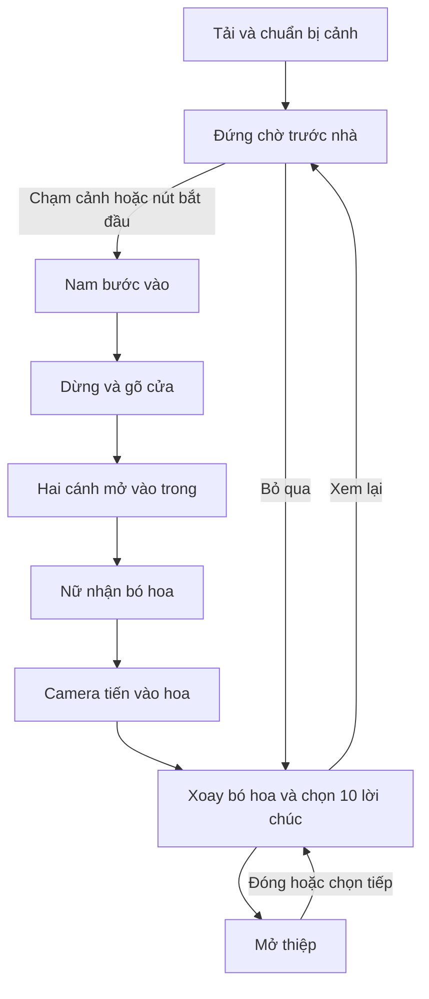

# Rose Wishes — Đặc tả sản phẩm và kịch bản hiện hành

[Tài liệu dự án](README.md) · [README · VI/EN](../README.md)

Phiên bản tài liệu: 01/11/2026. Tài liệu được viết lại theo mã và các điều chỉnh đã chấp nhận, thay cho mô tả ban đầu. Các yêu cầu cũ như 11 bông, ruộng lúa, nhà hàng xóm, cửa một cánh, tóc nữ uốn dài hoặc trang phục khác không còn mô tả phiên bản hiện tại.

Đây là đặc tả và tài liệu bàn giao, không phải mã thực thi. Các hướng dẫn trong tài liệu không tự cấp phép cài đặt, tải asset hay thay đổi hệ thống ngoài yêu cầu làm việc của người dùng.

## 1. Mục đích và phong cách

Tạo món quà tương tác cho Ngày Phụ nữ Việt Nam **20/10**. Trải nghiệm có câu chuyện chàng trai mang hoa tới nhà, cô gái mở cửa nhận, sau đó người xem khám phá 10 lời chúc. Không mở thẳng bó hoa ở lần truy cập bình thường; người xem vẫn có thể chủ động bỏ qua.

Hướng mỹ thuật là lãng mạn, tinh tế, tự nhiên. Bó hoa ưu tiên chi tiết nhất, nhìn được nhiều góc. Nhân vật trưởng thành, tỷ lệ thon, trang phục đời thường theo ảnh tham chiếu. Môi trường dựng thời gian thực có cây cách điệu; không mô tả là toàn bộ photorealistic.

## 2. Những yêu cầu đang áp dụng

- **10 hoa chính**, ID rose-01…rose-10, mỗi hoa mở đúng một thiệp; không chia đều bắt buộc theo vòng.
- Hoa phụ và lá chỉ trang trí, không nhận raycast mở thiệp.
- Nam đứng chờ thao tác bắt đầu rồi tự đi theo lối chính; không WASD, không yêu cầu chạm liên tục.
- Nhà có hai cánh cửa mỏng mở vào trong. Nữ đứng đúng cao độ hiên.
- Trước nhà là sân cỏ, chậu hoa hai bên lối, hộp thư gần đầu đường vào và rào hoa giấy chỉ mặt trước.
- Xích đu bên trái dưới cây tán rộng; cây hoa trắng ở bãi cỏ trước bên phải và các vùng vườn khác.
- Sau nhà có khoảng vườn rồi sông; cầu gỗ bên phải nối từ đường lớn; bờ xa có đường nhỏ rồi rừng.
- Mặc định ban ngày; toggle chuyển liên tục qua hoàng hôn dịu sang đêm có trăng/sao.
- VI/EN, lưu lựa chọn; dropdown tùy chỉnh; bố cục ổn định khi đổi bản dịch.
- Tải đủ tài nguyên và chuẩn bị GPU trước khi hiện cảnh; không thay mô hình tạm trong lúc đợi.
- Âm thanh mặc định tắt; hỗ trợ reduced motion, bàn phím và trải nghiệm thay thế không WebGL.

## 3. Hành trình

### Mở đầu

Overlay ghi “Chờ một chút nhé, có điều bất ngờ dành cho em…” và “Những điều đẹp đẽ luôn đáng để chờ đợi.” Không tiết lộ khu vườn/bó hoa ở thông báo tải. Khi sẵn sàng, nam hiện ở vỉa hè, nhà và sân trong khung 3/4, tiêu đề “Có một điều anh muốn gửi đến em…”. Chưa thao tác thì nam không tự đi.

### Đi tới và gõ cửa

Click vùng 3D hoặc nút bắt đầu chuyển từ idle sang walk. Nam đi về cửa rồi giảm tốc, dừng và gõ. UI có nút mở cửa trong giai đoạn gần cửa/gõ. Âm gõ chỉ khi âm thanh đã bật. Nút header không kích hoạt bước đi.

### Mở cửa và trao

Cửa hai cánh mở vào trong. Nữ áo xám, jeans ống rộng và tóc thẳng mái thưa xuất hiện trên hiên. Bó hoa chuyển mềm giữa hai anchor; IK điều chỉnh tay. Không yêu cầu mô phỏng ngón tay hay biểu cảm khuôn mặt đầy đủ: hiện dùng clip, IK và nội suy. Cảnh không có hệ vật lý va chạm toàn thân.

### Tiến gần và khám phá

Camera tiến về bó hoa, rồi sang studio 3D. Cùng palette/layout, dùng mức chi tiết phù hợp thay vì hoa khác. Người xem xoay, zoom và reset; không pan. Không có video trung gian.

### Đọc lời chúc

Click hoa chính hoặc nút 01–10 để mở thiệp. Có bông trước/tiếp, quay vòng đầu/cuối, Escape, đóng và quay lại bó hoa. Tiến độ lưu trong sessionStorage theo ID. Xem lại câu chuyện không tự xóa các hoa đã đọc.

## 4. Nội dung 10 hoa

Bảng này phản ánh wishes.ts. Khi sửa lời chúc, đồng bộ bảng và wishes.en.ts, giữ nguyên ID. Màu/vị trí thực tế do roses.ts và bouquet-layout.json quyết định; cột loại là mô tả nội dung, không thay dữ liệu mô hình.

| ID | Lo?i | Ti?u ?? | L?i ch?c |
| --- | --- | --- | --- |
| rose-01 | Đỏ nhung, nở lớn | Điều đẹp nhất | Chúc em ngày 20/10 ngập tràn niềm vui. Mong mỗi ngày đều có một lý do thật dịu dàng để em mỉm cười. |
| rose-02 | Hồng phấn, hé nở | Dịu dàng với chính mình | Mong em luôn yêu thương bản thân, nghỉ ngơi khi mệt và tự hào về những điều mình đã cố gắng. |
| rose-03 | Kem, nụ nhỏ | Những khởi đầu mới | Chúc những dự định của em từng chút một nở hoa, như nụ hồng đang chờ ngày rực rỡ. |
| rose-04 | Đỏ rượu, cánh xoắn | Luôn tỏa sáng | Em không cần giống bất kỳ ai. Chúc em luôn tự tin với vẻ đẹp và ánh sáng riêng của mình. |
| rose-05 | Hồng pastel, nở lệch | Bình yên nhé | Mong những ngày bận rộn vẫn dành cho em một khoảng trời bình yên và ấm áp. |
| rose-06 | Đỏ nhung, hé nở | Một chút may mắn | Chúc em gặp những điều tốt lành, những người chân thành và thật nhiều cơ hội tuyệt vời. |
| rose-07 | Hồng đào, nở lớn | Nụ cười của em | Mong nụ cười của em luôn được nâng niu, không chỉ hôm nay mà cả những ngày rất đỗi bình thường. |
| rose-08 | Trắng kem, cánh dày | Cảm ơn em | Cảm ơn em vì đã hiện diện và mang đến những điều đẹp đẽ theo cách riêng của mình. |
| rose-09 | Hồng đậm, nụ cao | Ước mơ của em | Chúc em đủ dũng cảm để bước tới điều mình mong muốn và đủ kiên nhẫn để tận hưởng hành trình. |
| rose-10 | Đỏ ruby, nở vừa | Dành riêng cho em | Mong em luôn được lắng nghe, thấu hiểu, trân trọng và yêu thương một cách chân thành. Một bó hoa nhỏ thay cho ngàn lời chúc: chúc em hạnh phúc, rạng rỡ và luôn là chính mình. Chúc mừng 20/10! |

## 5. Khung hình và responsive

Nhà là chủ thể cảnh mở, camera thấy đường, lối vào, cửa và bó hoa. Không để cây/rào che hành động. Mặt trời/trăng giữ góc trên. Tiêu đề và 20/10 nằm trong DOM vùng chính. Mobile giữ icon cho nút âm thanh/ngày đêm; thiệp phía dưới có cuộn.

Thông số camera, ánh sáng và inset được mô tả tại [framing-and-lighting.md](framing-and-lighting.md). Tọa độ và bố trí chi tiết tại [scene-design.md](scene-design.md).

## 6. Trạng thái, tải và ngoại lệ

Luồng dùng INTRO_READY, WALKING, AT_DOOR, KNOCKING, DOOR_OPENING, HANDOVER, BOUQUET_TRANSITION, BOUQUET_EXPLORE. Xem architecture.md cho thời gian và điều kiện.

Khi tải: Canvas ẩn, main inert, start/skip được chặn. Lỗi hiện lời nhắc và nút tải lại. Không có WebGL2: dùng SVG và các nút đọc đủ 10 lời chúc. SVG không phải placeholder lúc GLB đang tải.

## 7. Điều kiện kiểm nhận

1. Có đủ 10 ID/nội dung, hoa phụ không mở thiệp.
2. Nam chỉ đi sau lệnh; đi đúng lối, bó hoa ở trước, nữ không chìm nền.
3. Cửa mở đủ vào trong; kiểm tra trao hoa không cắt xuyên cửa trong luồng hiện hành.
4. Rào chỉ mặt trước, hai lối mở, hộp thư thấy được; cây che xích đu; sau sông là rừng.
5. Bó hoa xoay được nhiều góc, màu/layout thống nhất; kiểm tra xuyên cánh/bọc bằng quan sát.
6. Ngày/đêm và VI/EN hoạt động, keyboard/focus đúng, không tràn ngang.
7. Tải chậm/lỗi không hiện mô hình tạm hoặc mở tương tác sớm.
8. Build và kiểm tra phù hợp đạt; phân biệt kiểm tra tự động với đánh giá mỹ thuật thủ công.

## 8. Tài liệu kỹ thuật liên quan

[Thiết kế mô hình](model-design.md) · [Kiến trúc](architecture.md) · [Tải cảnh](scene-loading.md) · [Ngôn ngữ](languages.md) · [Công cụ](local-3d-tools.md) · [Nguồn/giấy phép](../public/models/LICENSES.md).

